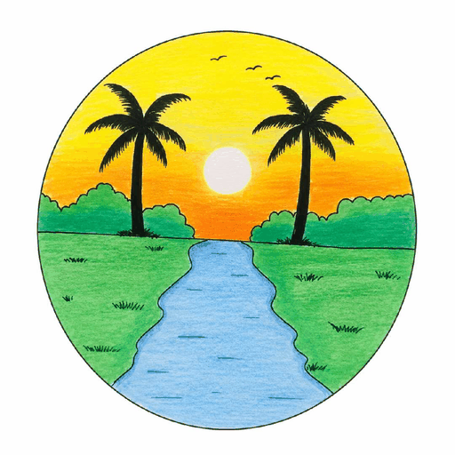

<!DOCTYPE html>
<html lang="ar" dir="rtl">
<head>
<meta charset="UTF-8">
<meta name="viewport" content="width=device-width, initial-scale=1.0">
<meta name="theme-color" content="#050b18">

<title>Alislamiah 465 | شبكة الإسلامية الرقمية</title>

<meta name="description" content="Alislamiah 465، بوابتك الموحدة لاكتشاف جميع مواقع وتطبيقات وخدمات شبكة الإسلامية الرقمية.">
<meta name="robots" content="index, follow">

<link rel="icon" href="icon.png" type="image/png">

</head>

<body>

<!-- الشريط العلوي -->
<header>
    <a href="#home" class="brand" aria-label="Alislamiah 465 - الصفحة الرئيسية">
        
        
Alislamiah 465

    </a>

    <button class="menu-button" id="menuButton"
            aria-label="فتح القائمة"
            aria-expanded="false"
            aria-controls="sidebar">
        
        
        
    </button>
</header>

<!-- خلفية القائمة -->

<!-- القائمة الجانبية -->
<aside class="sidebar" id="sidebar"
       aria-label="القائمة الرئيسية"
       aria-hidden="true">

    

        

            
            Alislamiah 465
        

        <button class="close-button" id="closeButton"
                aria-label="إغلاق القائمة">×</button>
    

    
القائمة الرئيسية

    <a href="#home" class="menu-link">
        ⌂
        الرئيسية
    </a>

    <a href="#about" class="menu-link">
        ◈
        عن الإسلامية
    </a>

    <a href="#services" class="menu-link">
        ▦
        خدمات الإسلامية
    </a>

    
روابط شبكة الإسلامية

    <a href="https://mohamedmadoui5195.github.io/Alislamiah-services/">
        🌐
        خدمات الإسلامية
    </a>

    <a href="https://mohamedmadoui5195.github.io/Alislamiah-_net/">
        ℹ️
        عن Alislamiah
    </a>
</aside>

<!-- الواجهة الرئيسية -->
<main>

<section class="hero" id="home">

    

    

        
            
            بوابتك إلى العالم الرقمي
        
    

    <h1>
        عالمك الرقمي 
        مع Alislamiah 465
    </h1>

    

        اكتشف جميع مواقع وتطبيقات وخدمات شبكة الإسلامية من مكان واحد.
        بوابة موحدة تجمع التعليم والبحث والتصفح والفيديوهات والخرائط
        والذكاء الاصطناعي والبريد الإلكتروني والتخزين السحابي.
    

    

        <a href="#services" class="btn btn-primary">
            اكتشف خدماتنا ←
        </a>

        <a href="#about" class="btn btn-secondary">
            تعرّف على الشبكة
        </a>
    

</section>

<!-- عن الإسلامية -->
<section class="section" id="about">

    

        
ABOUT ALISLAMIAH

        <h2>عن Alislamiah</h2>
        
تعرّف على رؤيتنا ومجال خدماتنا الرقمية

    

    

        

            
🌐

            <h3>شبكة الإسلامية الرقمية</h3>
        

        

            الإسلامية هي شبكة رقمية توفر خدمات متعددة، منها منصة تعليمية
            متكاملة ومتصفح آمن خالٍ من الإباحيات، بالإضافة إلى مجموعة من
            المنصات والخدمات الرقمية التي تهدف إلى توفير تجربة تقنية آمنة
            ومفيدة للمستخدمين.
        

    

</section>

<!-- المواقع والتطبيقات -->
<section class="section" id="services">

    

        
OUR DIGITAL ECOSYSTEM

        <h2>مواقعنا وخدماتنا وتطبيقاتنا</h2>
        
ثماني خدمات رقمية في بوابة واحدة

    

    

        <!-- 1: المنصة التعليمية -->
        <article class="service-card">

            

                
📚

                01 / 08
            

            <h3>منصة تعليمية</h3>

            

                تقدم لكم الإسلامية منصة تعليمية مجانية،
                تهدف إلى تسهيل الوصول إلى المحتوى التعليمي
                والخدمات المعرفية.
            

            <a class="service-link"
               href="https://mohamedmadoui5195.github.io/Alislamiah-_net/">
                الانتقال إلى Alislamiah-_net
                ←
            </a>

        </article>

        <!-- 2: محرك البحث -->
        <article class="service-card">

            

                
🔎

                02 / 08
            

            <h3>محرك بحث</h3>

            

                توفر الإسلامية محرك بحث يهدف إلى توفير
                تجربة بحث آمنة وموثوقة، مع التركيز على
                الوصول إلى محتوى مناسب للمستخدمين.
            

            <a class="service-link"
               href="https://mohamedmadoui5195.github.io/Alislamiah-AI/">
                الانتقال إلى Alislamiah AI
                ←
            </a>

        </article>

        <!-- 3: المتصفح -->
        <article class="service-card">

            

                
🌐

                03 / 08
            

            <h3>متصفح Alislamiah Bing</h3>

            

                توفر الإسلامية تجربة رقمية أخرى تناسب
                محبي الحداثة والتطور التكنولوجي،
                من خلال واجهة مخصصة للبحث والتصفح.
            

            <a class="service-link"
               href="https://mohamedmadoui5195.github.io/Alislamiah/">
                الانتقال إلى Alislamiah Bing
                ←
            </a>

        </article>

        <!-- 4: منصة الفيديوهات -->
        <article class="service-card">

            

                
▶️

                04 / 08
            

            <h3>منصة فيديوهات</h3>

            

                ولم تكتفِ الإسلامية بمحركات البحث فقط،
                بل توفر أيضًا Alislamiah Tube، منصة
                لمشاهدة الفيديوهات مع التركيز على
                المحتوى المفيد والملائم.
            

            <a class="service-link"
               href="https://mohamedmadoui5195.github.io/Alislamiah-Tube/">
                الانتقال إلى Alislamiah Tube
                ←
            </a>

        </article>

        <!-- 5: الخرائط -->
        <article class="service-card">

            

                
🗺️

                05 / 08
            

            <h3>تطبيق الخرائط</h3>

            

                طورت شبكة Alislamiah أيضًا تطبيق
                Alislamiah Maps لاستكشاف الأماكن
                والمواقع والاستفادة من خدمات الخرائط.
            

            <a class="service-link"
               href="https://mohamedmadoui5195.github.io/Alislamiah-Maps/">
                الانتقال إلى Alislamiah Maps
                ←
            </a>

        </article>

        <!-- 6: المساعد الرقمي -->
        <article class="service-card">

            

                
✦

                06 / 10
            

            <h3>المساعد الرقمي Gemalot</h3>

            

                توفر شبكة الإسلامية مساعدًا رقميًا
                يرافقك ويساندك في مهامك، ضمن تجربة
                تقنية مخصصة للمساعدة والإنتاجية.
            

            <a class="service-link"
               href="https://mohamedmadoui5195.github.io/Gemalot/">
                الانتقال إلى Gemalot
                ←
            </a>

        </article>

        <!-- 7: البريد الإلكتروني -->
        <article class="service-card">

            

                
✉️

                07 / 10
            

            <h3>البريد الإلكتروني Eisen Mail</h3>

            

                إلى جانب ذلك، تشمل تطبيقات الإسلامية
                خدمة Eisen Mail للبريد الإلكتروني،
                للتواصل وإدارة الرسائل عبر الإنترنت.
            

            <a class="service-link"
               href="https://mohamedmadoui5195.github.io/Eisen-mail/">
                الانتقال إلى Eisen Mail
                ←
            </a>

        </article>

        <!-- 8: التخزين السحابي -->
        <article class="service-card">

    

        
☁️

        08 / 10
    

    <h3>التخزين السحابي Bingot</h3>

    

        وختمت الإسلامية مشاريعها بتطبيق Bingot للتخزين السحابي،
        الذي يوفر مساحة لحفظ الملفات والصور والفيديوهات
        والوصول إليها عبر الإنترنت.
    

    <a class="service-link"
       href="https://mohamedmadoui5195.github.io/Bingot/">
        الانتقال إلى Bingot
        ←
    </a>

</article>

 <!-- 9: التقويم -->
        <article class="service-card">

            

                
🔎

                09 / 09
            

            <h3>التقويم </h3>

            

                توفر الإسلامية  تطبيق تقويم أيضا 
            

            <a class="service-link"
               href="https://mohamedmadoui5195.github.io/Eisen.Calendar/">
                الانتقال إلى  Eisen Calandar
                ←
            </a>

        </article>

<!-- 9: التقويم -->
        <article class="service-card">

            

                
🔎

                10 / 10
            

            <h3>التقويم </h3>

            

                توفر الإسلامية تطبيق ميت وإجتماعات
            

            <a class="service-link"
               href="https://mohamedmadoui5195.github.io/Eisen.metting/">
                الانتقال إلى  Eisen Meeting
                ←
            </a>

        </article>

</section>

<!-- الوصول إلى بقية خدمات الشبكة -->
<section class="closing">

    <h2>الإسلامية، عالم رقمي متكامل</h2>

    

        اكتشف المزيد من الخدمات والمنصات التي تقدمها شبكة الإسلامية.
    

    <a class="btn btn-primary"
       href="https://mohamedmadoui5195.github.io/Alislamiah-services/">
        استكشف خدمات الإسلامية ←
    </a>

</section>

</main>

<!-- التذييل -->
<footer>

    

        Alislamiah 465
    

    

        <a href="#home">الرئيسية</a>

        <a href="#about">عن الإسلامية</a>

        <a href="https://mohamedmadoui5195.github.io/Alislamiah-services/">
            خدمات الإسلامية
        </a>

        <a href="#services">جميع التطبيقات</a>

    

    

        جميع الحقوق محفوظة لشبكة الإسلامية ©
        
    

</footer>

</body>
</html>